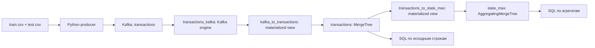

# HW2: Kafka → ClickHouse

Загрузка CSV с транзакциями из Teta ML в Kafka, автоматическая запись в ClickHouse и поиск категории самой крупной транзакции в каждом штате. Решение находится в ветке **`hw2`**; ветка `hw1` содержит предыдущее задание.

| Требование | Реализация |
|---|---|
| Отдельный Python-скрипт CSV → Kafka | [`scripts/publish_csv.py`](scripts/publish_csv.py) |
| DDL таблиц и загрузка Kafka → ClickHouse | [`sql/01_schema.sql`](sql/01_schema.sql) |
| SQL-запрос и результирующий CSV (пункты 2–3 задания повторяются) | [`sql/02_max_transaction_by_state.sql`](sql/02_max_transaction_by_state.sql), [`results/max_transaction_by_state.csv`](results/max_transaction_by_state.csv) |
| Оптимизация хранения и выполнения запроса | Финальный DDL в `01_schema.sql`, исходный вариант в [`sql/00_baseline.sql`](sql/00_baseline.sql), быстрый запрос в [`sql/03_max_transaction_by_state_optimized.sql`](sql/03_max_transaction_by_state_optimized.sql) |
| Воспроизводимый запуск | `Dockerfile`, `docker-compose.yml`, закреплённые версии в `requirements.txt`, команды ниже |

## Данные и смысл запроса

Источник: [соревнование Teta ML на Kaggle](https://www.kaggle.com/t/1918f3f6435300327d38d6c596f97394). Скачайте архив через Kaggle и распакуйте **`train.csv` и `test.csv`** в каталог `data/`. Исходные CSV не включены в Git. `sample_submition.csv` не нужен: он содержит шаблон предсказаний, а не транзакции.

В предоставленной версии `train.csv` содержит **786 431**, `test.csv` — **262 144** строки. Вместе это **1 048 575** транзакций, **51** код штата/округа (включая DC), **14** категорий. Проверенная выдача на обоих файлах сохранена в `results/max_transaction_by_state.csv`.

Используются реальные названия столбцов: `us_state` — штат, `cat_id` — категория, `amount` — сумма. Запрос возвращает **категорию отдельной транзакции с максимальной суммой** по каждому штату. Например, две покупки еды по 70 и одна поездка за 100 дадут категорию поездки, даже если суммарные расходы на еду больше.

Если суммы равны, выбирается запись с наибольшей парой `(source_file, source_row)`: сначала лексикографически имя файла, затем номер записи CSV, начиная с 1 после заголовка. Этот порядок одинаков в обоих SQL-запросах и Python-проверке. Формат результата: `us_state,cat_id,max_amount`.

Сохраняются все 18 исходных столбцов; в `test.csv` отсутствующий `target` записывается как `NULL`. Добавляются имя файла и номер записи. Деньги представлены как `Decimal(12, 2)`, индексы почты — как строки с сохранением ведущих нулей. В исходном времени нет часового пояса: при загрузке его значения условно трактуются как UTC, без сдвига часов.

## Запуск на полном наборе

Нужны Docker с Compose v2 и работающим Docker Engine. Рекомендуется выделить Docker минимум 4 GB RAM, 2 CPU и 6 GB диска. Образы поддерживают Linux amd64 и arm64, запуск проверен на Apple Silicon. Python на хосте нужен только для локальных тестов и генератора синтетических CSV; основной запуск выполняется в контейнерах. `make` — необязательная удобная обёртка.

```bash
git clone --branch hw2 https://github.com/proooooogiba/mlops-course.git
cd mlops-course
mkdir -p data results
# Скопируйте распакованные train.csv и test.csv в data/.
ls -lh data/train.csv data/test.csv

make up
make load
make verify
make benchmark
```

`make up` собирает Python-образ, ждёт готовности Kafka и ClickHouse, создаёт топик `transactions` с тремя партициями и применяет DDL. `make load` отправляет по одному JSON-сообщению на запись CSV и ждёт подтверждения доставки всех сообщений от Kafka. Загрузка потоковая: весь CSV не читается в RAM. Ошибка формата или доставки завершает скрипт с ненулевым кодом.

`make verify` ждёт загрузки данных в ClickHouse до 300 секунд, проверяет количество и уникальность исходных номеров записей, SHA-256 CSV, независимо вычисляет максимумы из файлов и сравнивает их с обоими SQL-запросами. Ожидаемый итог для полного набора:

```text
PASS: 1,048,575 rows; 51 states; CSV == raw SQL == optimized SQL
```

Новые результаты сохраняются в **`results/runtime/`**:

| Файл | Содержание |
|---|---|
| `load_manifest.json` | Источники, SHA-256, число доставленных записей, ограничение строк |
| `max_transaction_by_state.csv` | Результат текущего запуска |
| `verification.json` | Результат проверки полноты загрузки и совпадения ответов |
| `benchmark.json` | Замеры запросов и размеров хранения |

Этот каталог игнорируется Git. Проверенные результаты полного набора в `results/` сохраняются независимо от последующих локальных запусков.

Те же действия без `make`:

```bash
docker compose build producer
docker compose up -d --wait kafka clickhouse
docker compose run --rm clickhouse-init
docker compose run --rm producer
docker compose run --rm verify
docker compose run --rm benchmark
```

## Быстрая проверка

Для проверки на первых 1000 строках каждого файла вместо `make load` выполните:

```bash
make up
make smoke
```

`make smoke` публикует до 1000 записей из каждого CSV, затем выполняет ту же полную проверку для выбранного поднабора. Он запускается на пустом стенде. Если данные уже загружались, перед новым запуском очистите стенд:

```bash
make reset
make up
make load       # Или make smoke для быстрой проверки.
make verify
```

`make reset` удаляет **тома Kafka и ClickHouse только проекта `mlops-hw2`**, а также `results/runtime/`. Исходные CSV и сохранённая в Git выдача остаются. Обычный `make down` только останавливает и удаляет контейнеры: данные в томах сохраняются. После него `make up` и `make verify` продолжают работу с уже загруженными данными.

Повторная публикация исходных CSV создаёт новые Kafka-сообщения. Поэтому producer отказывается загружать данные при существующем манифесте; для нового прогона используйте `make reset`. Kafka → ClickHouse имеет семантику **at least once**: при сбое возможна повторная доставка. Здесь нет обещания exactly once. Проверка обнаруживает дубликаты по `(source_file, source_row)`; максимум при повторе идентичной записи остаётся тем же, но число строк увеличится. После частичной/неудачной загрузки также нужен reset.

## Устройство загрузки



Kafka engine служит источником для materialized view, а `MergeTree` хранит данные. Порядок DDL важен: при подключении Kafka materialized view уже существуют таблица агрегатов и её materialized view, поэтому первые записи тоже попадают в агрегаты. Группа `clickhouse-homework-v1` начинает чтение с самых ранних доступных сообщений; offsets сохраняются в Kafka. Ошибочные сообщения не пропускаются (`kafka_skip_broken_messages = 0`).

Брокер доступен внутри Compose как `kafka:9092`, ClickHouse — как `clickhouse:8123`. HTTP ClickHouse также опубликован на `127.0.0.1:8123`. Учебные логин/пароль: `homework`/`homework`. Если порт занят, скопируйте `.env.example` в `.env` и измените `CLICKHOUSE_HTTP_PORT`, например на `18123`; внутренние адреса менять не нужно.

## SQL вручную

Запрос по исходным строкам:

```bash
docker compose exec -T clickhouse clickhouse-client \
  --user homework --password homework \
  < sql/02_max_transaction_by_state.sql
```

Оптимизированный запрос:

```bash
docker compose exec -T clickhouse clickhouse-client \
  --user homework --password homework \
  < sql/03_max_transaction_by_state_optimized.sql
```

Чтобы сохранить выдачу самостоятельно, добавьте `> results/runtime/manual_result.csv` к любой из этих команд после успешного `make verify`.

## Оптимизация и измерения

`sql/00_baseline.sql` содержит исходный вариант: `MergeTree ORDER BY tuple()`, обычные строки и стандартное сжатие LZ4. `sql/01_schema.sql` — финальный оптимизированный DDL, который применяется при запуске.

1. **Типы и кодеки.** `LowCardinality(String)` для штата, категории, пола и источника; `ZSTD(1)` для столбцов, `Delta` для времени/номера строки, `Gorilla` для координат. Выбор проверяется фактическим размером данных; кодеки сами по себе не гарантируют ускорение любого запроса.
2. **Порядок хранения.** `(us_state, transaction_time, source_file, source_row)` группирует строки одного штата и позволяет индексу отсекать гранулы при фильтрации по штату. Месячные партиции удобны для отбора по периоду и обслуживания данных. Для запроса максимума по всем штатам за всё время нужны все партиции: само партиционирование не устраняет полный просмотр.
3. **Предагрегация.** `AggregatingMergeTree` хранит `argMaxState` по штату, поддерживаемый materialized view при вставке. `argMaxMerge` объединяет эти состояния во время запроса, даже если фоновые слияния ещё не завершились. После слияний полный запрос читает около 51 строки вместо миллиона. Это основное ускорение целевого запроса; исходные транзакции остаются доступны для других запросов.

`make benchmark` после проверки загрузки создаёт baseline как снимок исходных строк, выполняет `OPTIMIZE FINAL` для сопоставимого хранения, прогревает каждый запрос и запускает его пять раз. Проверяет равенство ответов, берёт `query_duration_ms`, `read_rows`, `read_bytes` и `memory_usage` из `system.query_log`, а размеры — из `system.parts`. Сравниваются baseline, оптимизированная исходная таблица и таблица агрегатов. Во время замера producer должен быть остановлен. Baseline остаётся для исследования и удаляется командой `make reset`.

Результаты полного прогона и интерпретация измерений: [`results/REPORT.md`](results/REPORT.md). Время зависит от машины и кэша, поэтому сокращение `read_rows` и `read_bytes` — более устойчивые показатели, чем отношение миллисекунд на небольшом локальном стенде. В обычной загрузке `OPTIMIZE FINAL` не требуется.

## Тесты и диагностика

Локальные тесты не требуют контейнеров:

```bash
python3 -m venv .venv
.venv/bin/python -m pip install -r requirements-dev.txt
make test PYTHON=.venv/bin/python
```

Проверяются точные суммы, ведущие нули индекса, отсутствие `target`, ошибки CSV, ограничения типов, отличие максимальной транзакции от суммы категории и равенство сумм между/внутри файлов. GitHub Actions дополнительно поднимает реальную Kafka и ClickHouse, публикует синтетические CSV с известными ответами, проверяет результат и запускает benchmark. Для запуска без Kaggle в **свежем клоне** можно создать этот набор командой `python3 -m tests.make_demo`, затем выполнить `make up load verify benchmark`. Генератор перезаписывает `data/train.csv` и `data/test.csv`, поэтому не запускайте его поверх скачанного набора.

Полезные команды:

```bash
docker compose ps -a
make logs
docker compose exec -T clickhouse clickhouse-client \
  --user homework --password homework \
  --query "SELECT * FROM system.kafka_consumers FORMAT Vertical"
```

Если producer не находит файл, проверьте `data/train.csv` и `data/test.csv`. При timeout загрузки смотрите ошибки ClickHouse и `system.kafka_consumers`, а не считайте успешное завершение producer подтверждением записи в ClickHouse. DDL с `IF NOT EXISTS` допускает повторную инициализацию, но не мигрирует существующую старую схему: после изменения структуры для учебного стенда выполните `make reset`.

Документация: [Kafka engine](https://clickhouse.com/docs/engines/table-engines/integrations/kafka), [AggregatingMergeTree](https://clickhouse.com/docs/engines/table-engines/mergetree-family/aggregatingmergetree), [официальный образ Kafka](https://hub.docker.com/r/apache/kafka).
