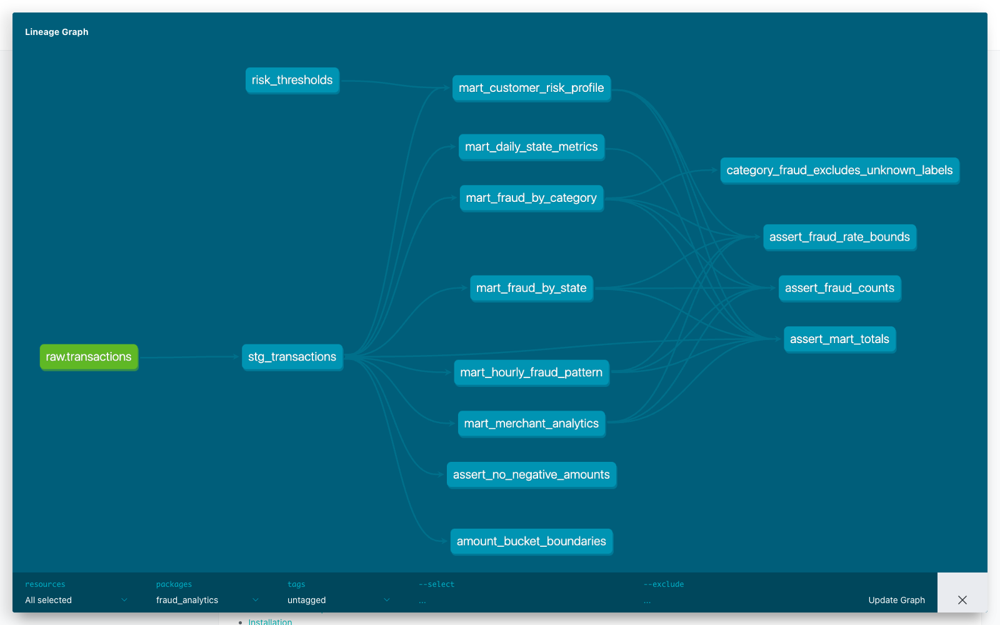

# HW4: dbt-проект аналитики транзакций

Добавлена цепочка `raw.transactions → stg_transactions → 6 marts` для датасета HW2.
В Docker источник — `transactions_db.transactions`, существующий источник HW2
`homework.transactions` поддерживается через `DBT_RAW_DATABASE`.

Версии: **dbt-core 1.9.10**, **dbt-clickhouse 1.9.5**, **ClickHouse 25.8.4.13**.

## Витрины

- `mart_daily_state_metrics`: количество, оборот, средний чек, P95, доля крупных операций.
- `mart_fraud_by_category`: фрод и оборот по категориям.
- `mart_fraud_by_state`: фрод по штатам, уникальные клиенты и мерчанты.
- `mart_customer_risk_profile`: история, средний чек, процент фрода и риск клиента.
- `mart_hourly_fraud_pattern`: фрод по дню недели и часу UTC.
- `mart_merchant_analytics`: оборот, процент фрода, флаг подозрительности мерчанта.

## Проверки и дополнительные требования

Использованы `dbt_utils`, `dbt_date`, `dbt_expectations`; собственные макросы
сегментации суммы и риска; ClickHouse dispatch для `dbt_date.day_of_week`.
Метаданные и бизнес-описания заданы для всех моделей и ключевых колонок.

- 61 generic test: `not_null`, `unique`, `accepted_values`, уникальность зерна,
  диапазон суммы через dbt_expectations.
- 4 singular tests: неотрицательные суммы, диапазон fraud_rate,
  согласованность счетчиков/NULL, сохранение количества и оборота.
- 2 unit tests: границы суммы/нормализация staging и исключение неизвестных
  меток из знаменателя fraud_rate.
- SQLFluff, `.pre-commit-config.yaml`, Makefile и отдельный Docker Compose.

## Валидация

На **786 431** исходной транзакции (4 504 фрода; оборот **55 239 932.49**):

```text
make hw4-check: PASS=75 WARN=0 ERROR=0 SKIP=0 TOTAL=75
# 7 моделей, 1 seed, 65 data tests, 2 unit tests
dbt test:       PASS=67 WARN=0 ERROR=0 SKIP=0 TOTAL=67
sqlfluff lint: All Finished! (exit 0)
dbt docs generate: Catalog written to target/catalog.json
```

[Полный лог проверки](evidence/check.log) · [Лог dbt test](evidence/dbt-test.log) ·
[Версии и размер источника](evidence/versions.log)



Запуск: `make hw4-up && make hw4-load && make hw4-check`, затем `make hw4-docs`.
`hw4-load` выполняется один раз для пустого изолированного источника.
Подробнее: [README](README.md).
